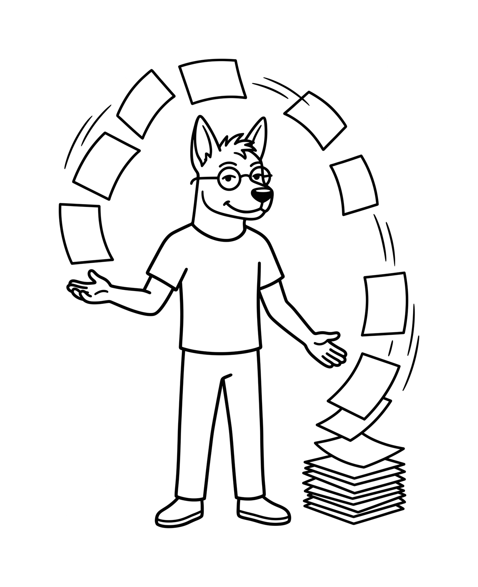

<p align="center">
  
</p>

# Dougie's Brain

**A second brain that maintains itself.**

For people who don't write code but want the power of Claude Code.


## What this is

Dougie's Brain is a markdown file-based second brain that runs inside Claude Code. All of your context, the details on all your projects, the people in them, and the decisions you have made live as plain text files on your computer and backed up to GitHub. Claude reads them at the start of every session, and it files, indexes and updates them automatically as you work.

Dougie's Brain solves four problems:

- **You are tired of briefing your AI before you can start working.** You spend time and effort at the start of every session adding files and writing detailed prompts to bring Claude up to speed on work it should already know.
- **Your chat memory is only a summary.** The memory stored in the Claude.ai chat interface is a distillation of your interactions. This means only limited details are captured and the rest is dropped, which in practice could lead to misaligned work.
- **Uploaded project files go stale.** Even when using the Projects feature in Claude.ai you have to constantly maintain the stored documents. The doc you attached in March is wrong by May, and you are the one who has to notice and swap it.
- **Every notes system needs upkeep.** Filing, indexing and linking are work, and most people are too busy and are never going to do it. But without the updates, the system becomes stale.

Dougie's Brain replaces the summary with the full record of every session, and the upkeep is handled by the system rather than by you.

## Who this is for

Dougie's Brain was designed for the rest of us who don't write code for a living.

Founders, consultants, operators, researchers, writers, and anyone doing work across several projects, companies, or areas of their life.

If you already use AI every day and you have moved to Claude Code or you are considering it, this is the foundation and head start you've been looking for or didn't know you needed. This is the structure that enables your AI to grow with you.

## What it does for you

- **Work with your context already loaded.**
	- Claude opens every session knowing your projects and the decisions inside them, so a short instruction replaces the briefing prompts:
		- Draft the client email that references what you agreed last meeting.
		- Write the proposal off the scope you actually discussed.
		- Pull a status update on a project you haven't touched in three weeks.
		- Answer "what did we decide about pricing and why" without opening a file.
- **Empty your head in one pass.**
	- Run `/brain-dump` and talk. Tasks, worries, an idea you had in the shower, how a meeting actually felt, in any order. The system sorts it, files the decisions, open questions and ideas into the right Area as their own notes, sends the tasks to your task manager, and tells you where every item went.
- **Turn meetings into finished work.**
	- Drop in a transcript, connect your notetaker, or let `/meeting-ingest` pull transcripts out of your email. Once the ingestion is complete, `/meeting-digest` automatically fires to extract the decisions, the owners, the open questions and the action items. From there you can ask Claude to send the follow-up email, write the proposal from the meeting it just read, or any other action you need to take.
- **Get help prioritizing.**
	- On a day with ten things and time for three, Claude reads your open work and your calendar and recommends what to do in what order and why. Run `/weekly-planning` and it reviews your outstanding tasks, what you finished last week and what has gone stale, then proposes your priorities and writes the ones you agree to into the Area. `/schedule-week` takes those priorities and blocks the time on your calendar. Need to change the schedule? Just ask.
- **Build finished client documents.**
	- Load your templates and brand guides once. Claude produces reports, proposals and slide outlines from the current state of a client's projects, so you edit rather than assemble.
- **And much more.**
	- The system is a foundation to create your workflows and use your tools. So, whatever work you do, whatever tool you connect, Claude now operates with your complete context.

## How it works

<p align="center">
  
</p>

**Context and Memory live in files, not a summary.**
Your context is the complete record: the details, the reasoning, the nuance, the things that seemed minor at the time. By contrast Claude.ai Memory compresses that into a summary and drops the rest. Nothing is dropped here. Claude writes the files and keeps them current as you work, and they are plain text on your own hard drive, so you can open any one and read exactly what Claude knows.

**It maintains itself, and it prevents context rot.**
Context rot is what happens to every notes system as it grows. Decisions get superseded but the old version stays and keeps getting cited. Notes drift out of date. Indexes stop matching the folders. New notes sit disconnected from everything related to them.

Three things prevent it:
1. Indexes rebuild themselves automatically every time a file changes.
2. `/distill` runs a deep sweep: it flags notes that contradict each other, links notes that belong together, and promotes what matters into the Area's highlights.
3. `/refresh-context` updates an Area's context file, then reports every change so you can correct or revert it. It stops for your input on two things only: a change it is not certain about, and removing a section. The vault gets more accurate as it gets bigger.

**Every turn is a save point.**
Any turn that changes a file commits to git, locally and to your private GitHub repository. Your vault backs itself up continuously, it is reachable from another machine, and any single change can be undone with one command.

## Where it comes from

Dougie's Brain borrows from Andrej Karpathy's [LLM wiki gist](https://gist.github.com/karpathy/442a6bf555914893e9891c11519de94f), Garry Tan's [gbrain](https://github.com/garrytan/gbrain), and a study of how many other second-brain systems work and where they fail. The goal was to take the best of each and build it into one system.

Karpathy's gist is the blueprint for a living wiki that gets richer as you add to it. From gbrain I took the concept that your memory should be something the agent actively maintains rather than a document you hand it.

Dougie's Brain takes that idea and makes it simple. Everything lives as files on your own computer, backs itself up to your private GitHub repository, and opens in Obsidian on your laptop or your phone. There is nothing to host and no external infrastructure to maintain.

## Key system concepts

**Review and revert.** Claude acts first, then reports what it did. You read the report and correct anything that came out wrong, instead of approving twenty-five small actions before any of them happen. Every turn is a save point, so nothing is unrecoverable.

- **Reversible by default.** Additive work happens without asking, even when it is significant, because you can undo it. Importance is a poor filter, since everything looks important while you are looking at it.
- **Irreversible actions.** Four of them stop and ask first:
	- deleting a file
	- a move that would break links pointing at it
	- overwriting something you wrote
	- publishing to a tool outside the vault
- **Judgment calls.** Anything the system cannot decide for you, such as whether a project is finished or which Area owns a note.

**Roles.** Commands are natively designed to never name a specific app. Instead they ask for a role, such as your task manager or your calendar, and `/setup` records which tool in your chosen stack fills each one. This is what keeps the system yours: it allows you to use your existing tools as well as change out a tool by simply asking Claude to make the change.

**Credentials.** System rule: your secret keys live in your computer's environment variables, never in a vault file. Nothing in the repository holds a secret, which is what makes backing it up to GitHub safe.

**Selective loading.** Five design choices keep token cost and context use down:

- The root `CLAUDE.md` is deliberately short and is the only thing always loaded.
- Each Area's own `CLAUDE.md` loads when you work in that Area and stays out of the way otherwise.
- `_index.md` tells Claude what an Area contains without reading every folder.
- `sources/` is never loaded wholesale.
- `/focus` narrows a whole session to a single Area.

**Markdown only.** The vault stores text, never binaries. A PDF, a photo or a recording stays where it already lives, on your drive or in your cloud storage, and `sources/` gets a markdown note that captures what matters and links back to the original. Your repository stays small and fast to clone, and Claude still reads the note.

## How your files are organized

Dougie's Brain uses an inverted PARA structure, derived from [Tiago Forte's PARA method](https://fortelabs.com/blog/para/). Inverted means Areas come first and Projects sit inside them, which keeps the domains of your life separated, both work and personal. That separation is what gives you and Claude cognitive isolation between one domain and the next.

An Area is a domain: a business, a property, your health. Each Area folder holds four sub-folders and two files.

**Area folder tree**

- `projects/`
- `ongoing/`
- `sources/`
- `archive/`

**Area system files**

- `CLAUDE.md` holds your rules and preferences for that Area.
- `_index.md` is a running index of what the Area contains.

Together this structure helps Claude load only the context a task needs.

To start a new Area tell Claude you have started something new and it will build the Area folder structure for you.

Within the folders each file is separated and organized by who wrote it. Anything authored outside the vault goes in `sources/` and is never edited: contracts, reports, transcripts, articles. Anything you or Claude write goes in `projects/` or `ongoing/`. Keeping the two apart means your sources of truth stay intact, so a note that cites a document is still pointing at the document as it was written.

The original file itself stays outside the vault. A contract in `sources/` is a markdown note holding the terms that matter and a link to the PDF on your drive; an image is a description and a link. Register the external folder in the Area's `CLAUDE.md` once and Claude reads from it on demand.

**Example vault structure**
```
0-Inbox/                        anything you haven't sorted yet
1-Areas/
  Business-1/
    CLAUDE.md                   what Claude should know about this Area
    _index.md                   a table of contents Claude keeps current
    projects/                   work with an end date
      client-1-proposal/
        scope-and-pricing.md
        meeting-2026-03-14.md
      q4-pricing-review/
    ongoing/                    notes that stay useful over time
      client-roster.md
    sources/                    notes on things other people wrote, never edited
      vendor-contract.md        key terms, linked to the PDF on your drive
    archive/                    finished work and old history
  Business-2/
  Personal/
2-Resources/                    reference that cuts across Areas
3-Archives/                     whole Areas you've retired
```

## The commands

Every command is a saved routine written in a readable markdown file. Type the slash command to run it.

```
/setup              run this first to configure your vault and connect your tools
/daily-checkin      morning view of your calendar and what is open
/brain-dump         you talk, it sorts, logs, and publishes
/capture            file something automatically without deciding where it goes
/focus              load context for one Area to do deep work

/weekly-planning    identifies priorities and helps you plan your week
/weekly-review      vault update and clean up: inbox, stale projects, open decisions
/schedule-week      turns priorities and tasks into calendar blocks

/file-this          saves important content from chat outputs before it is lost
/distill            promotes what matters into Area highlights
/refresh-context    updates Area context after things change
/archive            retires a finished project

/meeting-ingest     pulls transcripts in and files them by Area
/meeting-digest     extracts decisions, questions and action items

/update-system      updates your commands and hooks from the Dougie's Brain
                    repo, without touching your notes
/system-review      surveys what changed in the system recently
/find-solution      searches for an existing tool before building one
```

When to reach for what:

| Rhythm | Commands |
|---|---|
| **Every day** | `/daily-checkin` · `/brain-dump` · `/capture` · `/focus` |
| **Every week** | `/weekly-planning` · `/weekly-review` · `/schedule-week` |
| **Filing and knowledge** | `/file-this` · `/distill` · `/refresh-context` · `/archive` |
| **Meetings** | `/meeting-ingest` · `/meeting-digest` |
| **The system itself** | `/setup` · `/update-system` · `/system-review` · `/find-solution` |

Six scripts run on their own. You never touch them.

```
ensure-main.sh        puts you back on the main branch before anything writes
auto-pull.sh          commits stray edits, then pulls what other machines pushed
session-briefing.sh   briefs Claude on recent activity, inbox and stale projects

auto-index.sh         regenerates the touched Area's _index.md
mark-dirty.sh         marks that this turn changed something

commit-on-stop.sh     stages, commits and pushes everything that changed
```

The first three scripts run at session start, the next two when a file changes, the last at the end of every turn. [`ARCHITECTURE.md`](ARCHITECTURE.md) covers how they fit together and [`START_HERE.md`](START_HERE.md) is the full manual.

## Example command in action:
### `/brain-dump`

You talk in whatever order things occur to you. `/brain-dump` sorts what you said into tasks, decisions, open questions and ideas, writes the vault files immediately, and reports where each one went. It asks once, and only about what leaves the vault.

```
> /brain-dump

  Had the kickoff with Client 1 this morning. They want pricing revised
  before Friday and Sam is sending their brand files over. We agreed to
  push the launch to March, so the whole Q1 timeline moves. Book the van
  service and stop at the pharmacy after work. I keep meaning to write
  that onboarding checklist. And I'm starting to think the retainer model
  is wrong for this client.

Brain dump filed.

  Vault record   0-Inbox/brain-dumps/2026-03-14-brain-dump.md

  Decisions      1-Areas/Business-1/ongoing/decisions/
                   2026-03-14_launch-moved-to-march.md

  Questions      1-Areas/Business-1/ongoing/questions/
                   2026-03-14_is-retainer-right-for-client-1.md

  Ideas          1-Areas/Business-1/ongoing/ideas/
                   2026-03-14_client-onboarding-checklist.md

  Task manager   Revise Client 1 pricing        Business-1   due Friday
                 Draft onboarding checklist     Business-1
                 Book van service               Personal
                 Stop at pharmacy               Personal

  Inbox          1 item to sort later
                   Sam is sending brand files, destination unclear
```

Everything except the tasks is a markdown file in your vault, written whether or not you have connected a single outside tool. If an item went to the wrong place, say so in a sentence and Claude moves it, and it will often update your Area rules at the same time so the next one of its kind routes correctly.

## A foundation, not a finished system

I use this every day and it keeps evolving. I have run it on my own work since April 2026. My copy holds 925 notes across 8 Areas and 15 active projects, plus 23 index files it keeps current without me touching them.

Installing this gives you a solid foundation. However, it is important to know some of the limitations that are inherent in working with Claude.

Here are my observations:

- It makes good calls about what matters, but it gets some of them wrong. Sometimes it loses a thread and you have to steer it back. This is also why, by design, every turn is revertible. You must remain the reviewer and the editor.
- It won't nail your voice on the first pass. It gets closer as the vault fills with things you have written. The more examples of what you consider "good writing" it has, the better its output gets. But plan on reading and lightly editing anything that goes out under your name.
- Its reach grows as you connect your tools. They are not all wired up in advance. But when you hit something Claude can't do yet, just ask for it to find a solution. Use `/find-solution` to search the internet for an existing tool, skill, or MCP before building anything.

## System Requirements:

- **Claude Code**, on your existing Claude plan.
- **A free GitHub account**, for your private backup.
- **git and Bash.** Macs and Linux have both. On Windows, [Git for Windows](https://git-scm.com/download/win) installs both at once.
- **[Obsidian](https://obsidian.md/)**, optional and recommended. It opens the same folder with a real editor and search.

## Get started

> **Warning: keep the vault out of cloud-sync folders.** Your vault is a git repository that backs itself up. Putting it inside OneDrive, Dropbox, iCloud Drive or Google Drive puts two sync engines on the same files, which corrupts git history and can eat notes. On Windows, check before you choose: OneDrive syncs Documents and Desktop by default. Safe locations are your home folder (`C:\Users\you` or `~/`) or a plain folder like `C:\vaults\`. GitHub is already your backup and optional Obsidian (sync subscription required) handles phone access, so cloud sync adds risk and no benefit.
### Let Claude set it up

1. Install Claude Code and create a GitHub account if you don't have one.
2. Open Claude Code in the folder where you want your vault to live, such as your home folder (see the cloud-sync warning above). Claude creates the vault folder inside whichever folder it is running in.
3. Paste the message below. Replace `[my-brain]` with whatever you want your vault called.

> Set up Dougie's Brain for me: clone https://github.com/dougthewatson/dougies-brain.git into a folder called [my-brain], keep the template connected as "upstream", help me create a private GitHub repository of my own as "origin" and push to it, then run /setup.

4. Claude clones the template and sets up both repositories. It will stop and ask you to do the couple of steps it can't, such as logging in to GitHub.
5. `/setup` then runs on its own. It asks who you are, how you work, and which of your tools to connect, one question at a time. Your answers get written into the system as you go.
6. Read [`START_HERE.md`](START_HERE.md) when you are done. It is the full manual and it covers the daily rhythm.

### Do it yourself

1. On [GitHub](https://github.com), click **+** in the top right and choose **New repository**. Name it `my-brain`, select **Private**, leave the checkboxes unticked, and create it.
2. Open a command line. On Windows press Start and type **PowerShell**. On a Mac, open **Terminal**.
3. Paste these lines, swapping your username and repo name into the fourth:

```bash
git clone https://github.com/dougthewatson/dougies-brain.git my-brain
cd my-brain
git remote rename origin upstream
git remote add origin https://github.com/<your-username>/<your-repo>.git
git push -u origin main
```

Lines 3 and 4 tell git that the template is `upstream` and your private repo is home, which is what lets `/update-system` pull improvements later. If you see `error: remote origin already exists`, line 3 got skipped: run `git remote rename origin upstream`, then repeat line 4. Then start Claude Code inside the folder, run `/setup`, and read [`START_HERE.md`](START_HERE.md) for the full manual.

**Once you're in:** tell Claude "set up an Area for my business" and it builds the folders, the index and the context file. Ask it to delete `Example-Area` once you have seen how one is put together. When you don't know where something goes, put it in `0-Inbox/` and sort it later with help.

## Make it yours

Once installed, the system gets more valuable every day you use it, because everything you put through it stays available to the next session. It is a foundation rather than a finished product, so you can expand it to suit the way you work.

[Issues](https://github.com/dougthewatson/dougies-brain/issues) and pull requests are welcome: fixes, new commands, better fallbacks for tools I do not use. If you fork it into something different, that is the point. `/update-system` pulls improvements into your copy without touching your content, and every change is in [`CHANGELOG.md`](CHANGELOG.md).

Built by [Doug Watson](https://github.com/dougthewatson). MIT licensed, see [`LICENSE`](LICENSE).
